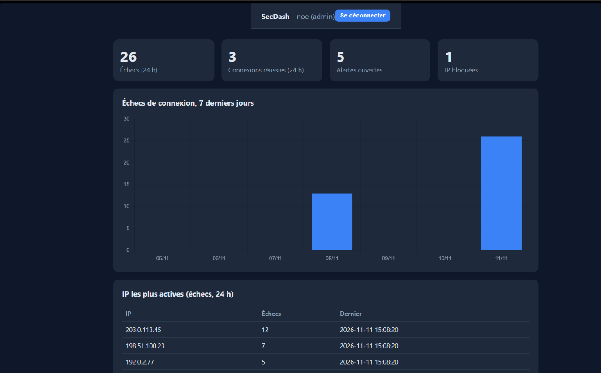
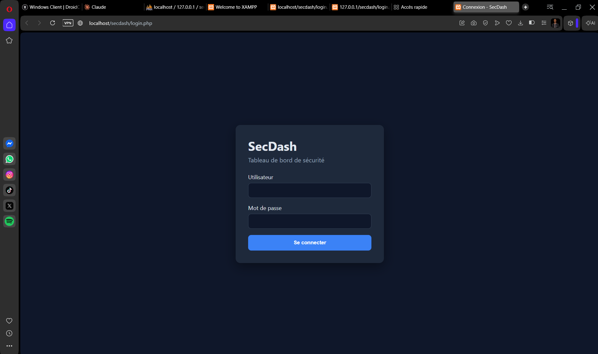
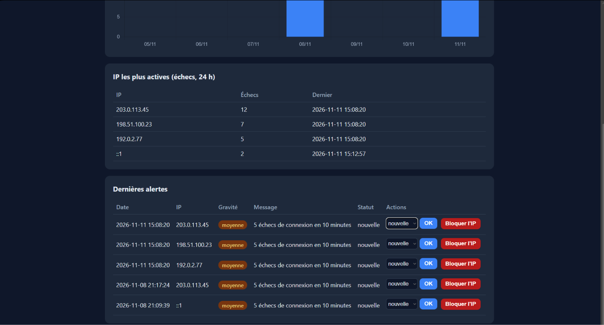

# SecDash

Tableau de bord de sécurité qui collecte les événements de connexion, repère les adresses IP suspectes et crée des alertes. Projet personnel réalisé en PHP et MySQL.



## Pourquoi ce projet

Les tentatives de connexion répétées sont le premier signe d'une attaque par force brute, mais elles passent inaperçues quand personne ne lit les journaux. SecDash rend ces signaux visibles et actionnables.

## Fonctionnalités

- **Authentification sécurisée** pour les administrateurs et analystes
- **Collecte des journaux** : connexions réussies, échecs, accès refusés
- **Détection** : 5 échecs en 10 minutes depuis la même IP créent une alerte (gravité moyenne, puis haute à partir de 10 échecs)
- **Tableau de bord** : indicateurs sur 24 h, graphique des échecs sur 7 jours, IP les plus actives
- **Gestion des alertes** : statuts nouvelle, en cours, résolue ; blocage manuel d'une IP (rôle admin)
- **API d'ingestion** protégée par clé pour recevoir les journaux d'autres machines

## Captures d'écran

| Connexion | Alertes |
|---|---|
|  |  |

## Mesures de sécurité

- Mots de passe hachés avec `password_hash` (bcrypt), rehachage automatique si l'algorithme évolue
- Requêtes préparées PDO partout (protection contre l'injection SQL)
- Jeton CSRF sur tous les formulaires
- Session régénérée à la connexion, cookie `HttpOnly` et `SameSite=Strict`, expiration après 30 minutes d'inactivité
- Verrouillage du compte 15 minutes après 5 échecs ; message d'erreur volontairement vague
- En-têtes HTTP de sécurité (`Content-Security-Policy`, `X-Frame-Options`, `X-Content-Type-Options`, `Referrer-Policy`)
- Sortie HTML systématiquement échappée
- Compte MySQL dédié aux droits limités (pas de `root`)
- Seul le dossier `public/` est exposé par le serveur web ; configuration et secrets restent hors de portée du navigateur
- API : clé comparée avec `hash_equals`, validation stricte des champs, taille du corps limitée à 10 Ko

## Technologies

PHP 8, MySQL/MariaDB, Apache (XAMPP), Chart.js, HTML/CSS.

## Structure

```
secdash/
├── config/          connexion à la base, secrets (non publiés)
├── includes/        auth, CSRF, détection
├── public/          seul dossier exposé
│   ├── api/         API d'ingestion
│   └── assets/      CSS et JavaScript
├── sql/schema.sql   structure de la base
└── tools/           création du premier administrateur
```

## Installation (XAMPP, Windows)

1. Copiez le projet dans un dossier, par exemple `D:\secdash`.
2. Dans `httpd.conf`, ajoutez l'alias qui expose uniquement `public/` :

   ```apache
   Alias /secdash "D:/secdash/public"

   <Directory "D:/secdash/public">
       Options FollowSymLinks
       AllowOverride All
       Require all granted
   </Directory>
   ```

3. Démarrez Apache et MySQL, puis importez la base. Avant l'import, remplacez dans `sql/schema.sql` le mot de passe provisoire de `secdash_user` par le vôtre :

   ```
   mysql -u root < sql/schema.sql
   ```

4. Créez vos fichiers de configuration :

   ```
   copy config\db.example.php config\db.php
   copy config\secrets.example.php config\secrets.php
   ```

   Renseignez le mot de passe de la base dans `db.php`, et une clé aléatoire dans `secrets.php` :

   ```
   php -r "echo bin2hex(random_bytes(32));"
   ```

5. Créez le premier administrateur :

   ```
   php tools/create_admin.php
   ```

6. Ouvrez `http://localhost/secdash/login.php`.

## Tester l'API

```powershell
$body = @{ event_type="login_failed"; username="root"; ip_address="203.0.113.45"; user_agent="test" } | ConvertTo-Json
1..6 | ForEach-Object {
  Invoke-RestMethod -Uri "http://localhost/secdash/api/ingest.php" -Method Post `
    -Headers @{ "X-API-Key" = "VOTRE_CLE" } -ContentType "application/json" -Body $body
}
```

Après six envois, une alerte apparaît dans le tableau de bord pour `203.0.113.45` (adresse réservée à la documentation).

## Limites connues et pistes

- Pas encore de HTTPS : à ajouter avant tout usage hors d'un poste local
- Pas de double authentification (TOTP) pour les administrateurs
- Pas de limitation de débit sur l'API
- Le blocage d'IP agit sur la page de connexion, pas au niveau du pare-feu
- À venir : page de consultation des journaux avec filtres, déblocage d'IP, export CSV

## À propos de l'auteur


**Noé Kamba Katanu**, étudiant en master réseaux et cybersécurité à l'Université de Kinshasa (UNIKIN). Mes centres d'intérêt : la détection des attaques, la sécurité défensive et l'impact de l'intelligence artificielle sur la cybersécurité.

- GitHub : [NOE-KATANU167](https://github.com/NOE-KATANU167)
- LinkedIn : www.linkedin.com/in/noé-katanu-80147b343 
